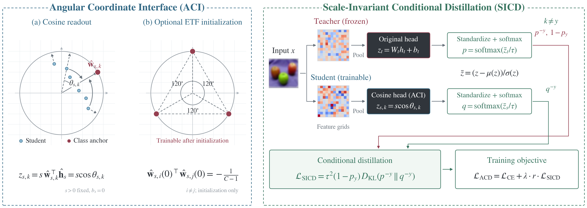
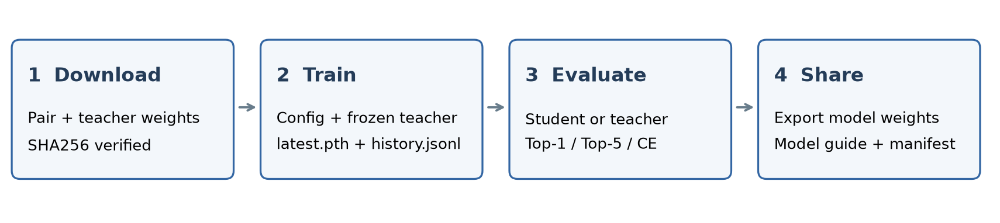
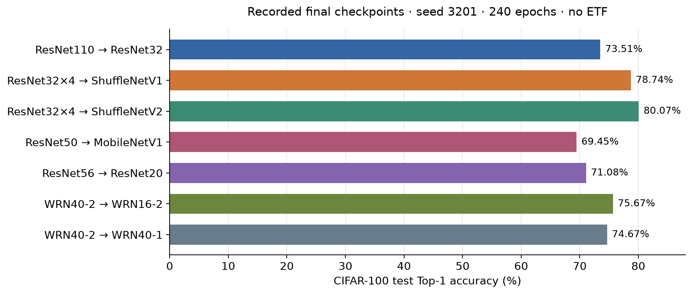
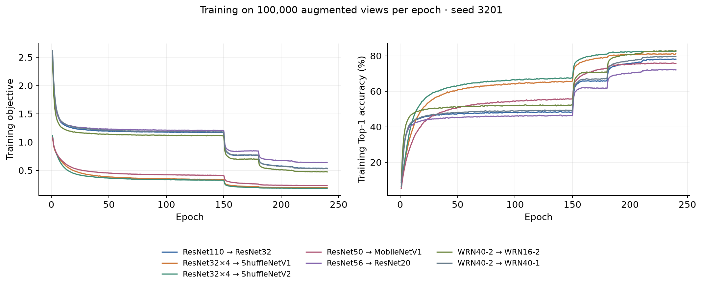

# ACD: Angular Conditional Distillation

PyTorch implementation of the **Angular Coordinate Interface (ACI)** and **Scale-Invariant Conditional Distillation (SICD)** for image classification. This repository provides training and evaluation, reproducible configs, pretrained CIFAR-100 students and teachers, and plotting tools.



[Paper](acd_v1.pdf) · [Supplementary-material draft](supplementary/README.md) · [Training guide](docs/usage.md) · [Model guide](docs/model_guide.md) · [Checkpoint coverage](docs/checkpoint_audit_20261118.md) · [Reproduction scope](docs/reproduction.md) · [Repository review](docs/repository_review.md)

## Install

Use Python 3.11+ and install a matching PyTorch/torchvision pair for your hardware, then run these commands from the repository root:

```bash
pip install -e .
python -m unittest discover -s tests -v
```

Optional plotting tools: `pip install -e '.[figures]'`. Locally checked with Python 3.12, PyTorch 2.9.0, torchvision 0.24.0 and NumPy 1.26.4. The reference trainer uses float32, with TF32 disabled.

## Download and evaluate a pretrained student

```bash
python -m tools.download_models --pair res56_res20 --student-only
python train.py --config configs/res56_res20.json \
  --data-root data --download \
  --evaluate checkpoints/acd_res56_res20_s3201_e240.pth \
  --metrics-json outputs/res56_res20_eval.json --device cuda:0
```

For CPU evaluation, use `--device cpu --workers 0`. The download utility verifies SHA256 and reuses matching local files. Evaluation needs neither a teacher checkpoint nor a training loader. CIFAR-100 uses the official torchvision archive, which includes both splits; ImageNet evaluation needs only `val/<class>/` folders in the original 1,000-class order.

## Train and resume



Download the selected pair, including its teacher, and start training:

```bash
python -m tools.download_models --pair res56_res20
python train.py --config configs/res56_res20.json \
  --data-root data --download \
  --teacher-checkpoint checkpoints/teacher_resnet56_cifar100.pth \
  --output outputs/res56_res20_acd --device cuda:0
```

Resume from a completed epoch with the same configuration, teacher file and output directory:

```bash
python train.py --config configs/res56_res20.json --data-root data \
  --teacher-checkpoint checkpoints/teacher_resnet56_cifar100.pth \
  --resume outputs/res56_res20_acd/latest.pth \
  --output outputs/res56_res20_acd --device cuda:0
```

Each run writes `config.json`, `history.jsonl`, an epoch-boundary `latest.pth`, and `final.json` with the final checkpoint hash. For a one-step execution check, add `--max-steps 1 --workers 0 --device cpu` and choose a separate output directory. Its `smoke.pth` is incomplete and cannot resume training. Exported Release weights contain no optimizer or scheduler and are for evaluation or use as frozen teachers.

See the [training guide](docs/usage.md) for teacher evaluation, ablations, ImageNet folders, checkpoint export and common errors.

## Released CIFAR-100 models

Release: **`cifar100-rerun-20261116`** in this repository's GitHub Releases. It contains **7 students + 5 distinct teachers**, about **170 MB** of weights, matching configs, a model guide, a manifest and SHA256 checksums. Download a pair with the commands above, or use `python -m tools.download_models --all`.

| Config / pair | Teacher → student | Final Top-1 (%) |
|---|---|---:|
| `res56_res20` | ResNet56 → ResNet20 | 71.08 |
| `res110_res32` | ResNet110 → ResNet32 | 73.51 |
| `wrn402_wrn162` | WRN40-2 → WRN16-2 | 75.67 |
| `wrn402_wrn401` | WRN40-2 → WRN40-1 | 74.67 |
| `res32x4_sv1` | ResNet32×4 → ShuffleNetV1 | 78.74 |
| `res32x4_sv2` | ResNet32×4 → ShuffleNetV2 | 80.07 |
| `res50_mv1` | ResNet50 → MobileNetV1 | 69.45 |



These are **single-seed reruns: seed 3201, final epoch 240, cosine head without ETF**. Every exported student was evaluated again on the official 10,000-image test split; all seven Top-1 results match the archived records. They are separate from the manuscript's historical multi-run results. See [model provenance and verification](docs/model_guide.md).

## Historical classifier controls and an additional teacher

Release **`cifar100-head-controls-20261031`** supplements the ACD students with **11 ordinary-KD head controls + the VGG13 teacher** (about 120 MB). It includes affine/cosine/ETF comparisons for ResNet32×4 → ResNet8×4, affine/cosine VGG13 → VGG8, and cosine/ETF pairs for three compact-student transfers. These controls use ordinary KL distillation; their recipes and seeds differ from the full ACD reruns.

```bash
python -m tools.download_models --manifest docs/head_controls_manifest.json --list
python -m tools.download_models --manifest docs/head_controls_manifest.json \
  --model ci_kd_res32x4_res8x4_s2051_e240.pth --student-only
python train.py --config checkpoints/ci_kd_res32x4_res8x4_s2051_e240.json \
  --data-root data --download --workers 0 --device cpu \
  --evaluate checkpoints/ci_kd_res32x4_res8x4_s2051_e240.pth
```

The downloader includes the matching configuration. `--pair` selects all controls for a pair; `--model` selects one filename. VGG13 is now available for training either VGG-teacher ACD configuration. See the [control model guide](docs/head_controls_guide.md) for scores, teacher commands and comparison limits, and the [KD Release audit](docs/kd_release_audit.md) for selection and provenance.

## Plot your training run

```bash
pip install -e '.[figures]'
python -m tools.plot_history --history outputs/res56_res20_acd/history.jsonl \
  --output outputs/res56_res20_acd/curves
```

The command writes PNG, SVG and PDF plots of training loss and evaluation accuracy. The repository also includes archived training curves and their source data:



The curves above show training metrics on 100,000 augmented views per epoch. They are not validation curves. Figure sources and regeneration commands are in [figs/README.md](figs/README.md).

## Method and ablations

ACI uses a bias-free cosine student head with fixed scale and trainable classifier directions. SICD standardizes both models' logits over all classes, transfers the teacher-mass-weighted conditional distribution over non-target classes, and optionally matches its backbone-gradient norm to standardized full KL. The teacher stays frozen.

| `--method` | Student head | Distillation objective |
|---|---|---|
| `ce` | Affine | Supervised CE only; no teacher needed |
| `kd` | Affine | Ordinary full KL |
| `angular_kd` | Cosine | Ordinary full KL |
| `standardized_full` | Cosine | Full KL on standardized logits |
| `conditional` | Cosine | Conditional KL without gradient matching |
| `acd` | Cosine | Conditional KL with gradient matching |

`--etf` enables optional simplex ETF initialization for cosine heads when feature dimension `d >= C-1`. It does not freeze classifier directions. Infeasible dimensions and affine-head ETF requests produce an error. Released checkpoints use `etf: false`. [Implementation details](docs/reproduction.md) explain the standardization, gradient matching and augmentation conventions.

## Repository map

| Path | Purpose |
|---|---|
| `train.py` | Training, resume, student/teacher evaluation |
| `acd/` | Heads, losses, data, checkpoint loading and model definitions |
| `configs/` | 11 CIFAR-100 pair configs and 2 ImageNet examples |
| `tools/` | Download/export weights, plot history, prepare/verify releases |
| `figs/` | README graphics with PNG, SVG and PDF versions |
| `results/` | Archived metrics and compact training histories |
| `supplementary/` | Evidence-scoped LaTex draft and machine-readable claim manifest |
| `docs/` | Usage, model guide, provenance, scope and validation |
| `tests/` | Numerical invariants and training/evaluation workflow checks |

Only seven CIFAR pairs have released complete runs. Other CIFAR configs and the ImageNet examples describe supported experiments; they do not imply verified final scores. Detection, AMP, DDP and gradient accumulation are outside the current trainer. The model and augmentation sources retain upstream attribution; [source_manifest.json](docs/source_manifest.json) records their origins.

本轮七组对照的配方搜索、训练设置与后台队列说明见 [11 对模型训练记录](docs/seven_arm_training_20261118.md)。
