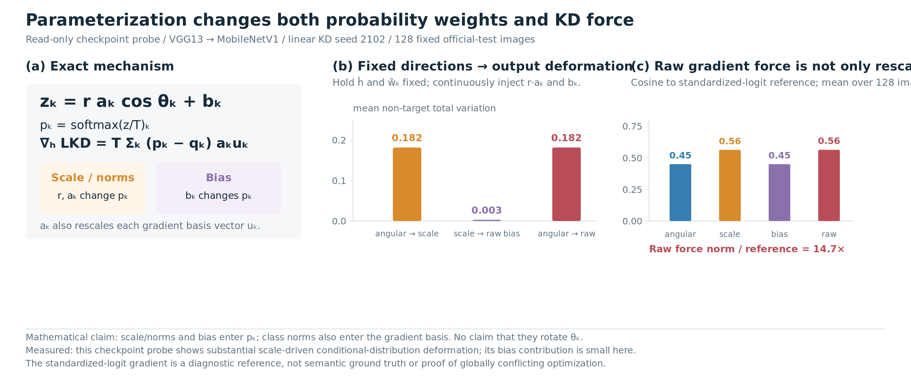
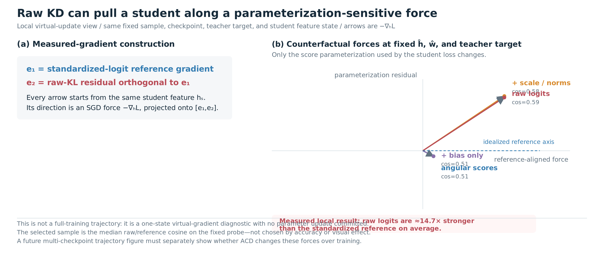
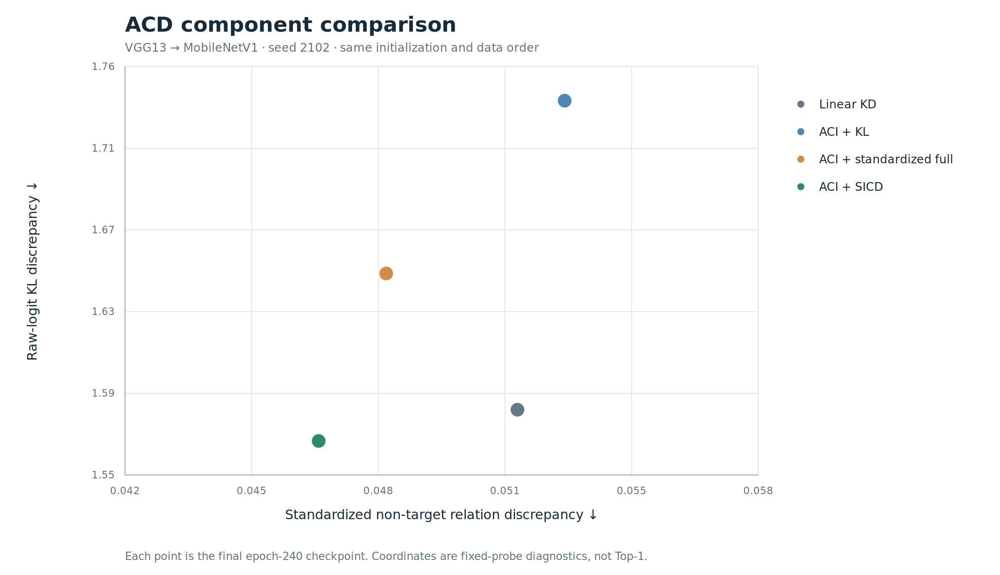
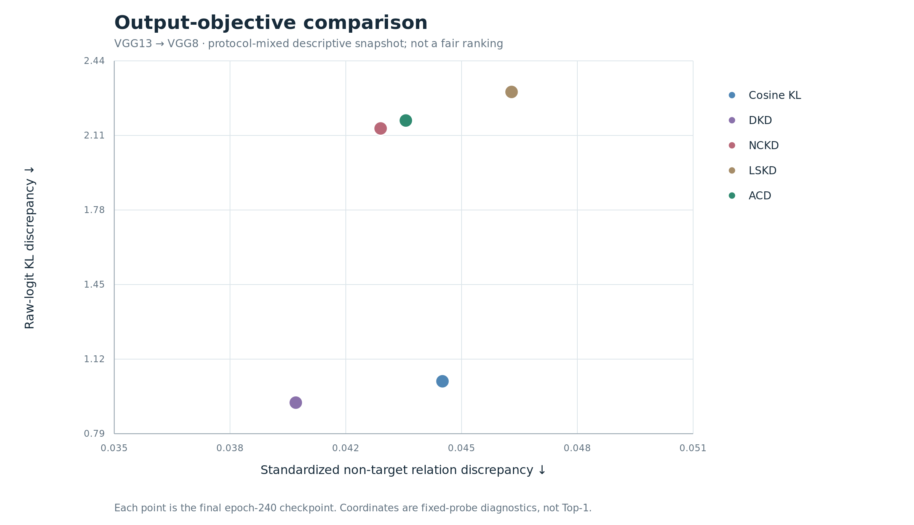
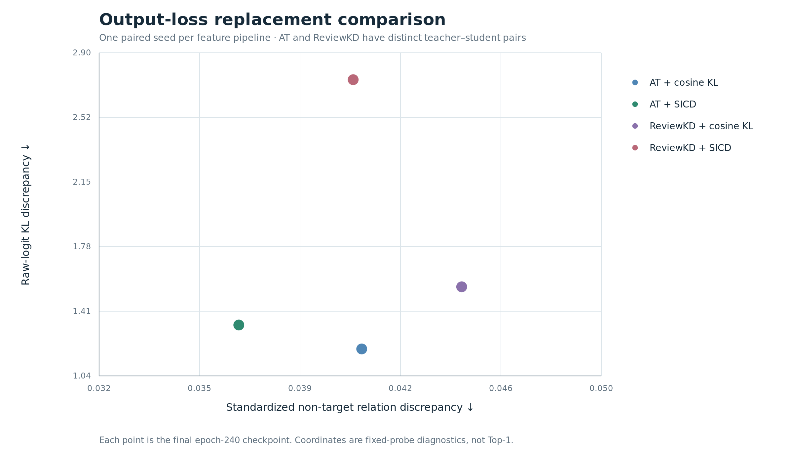
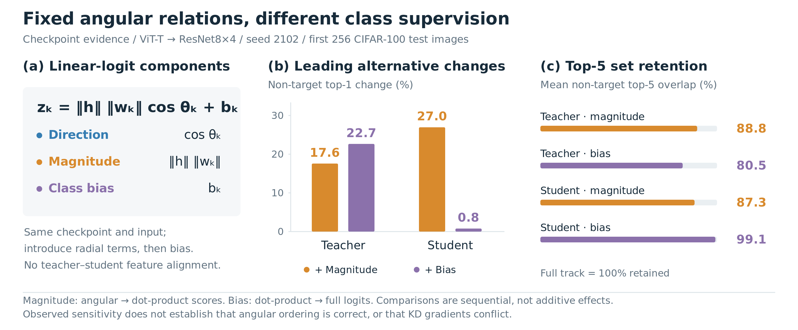
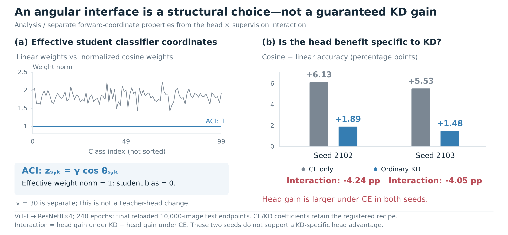
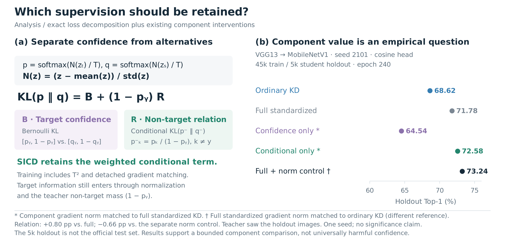
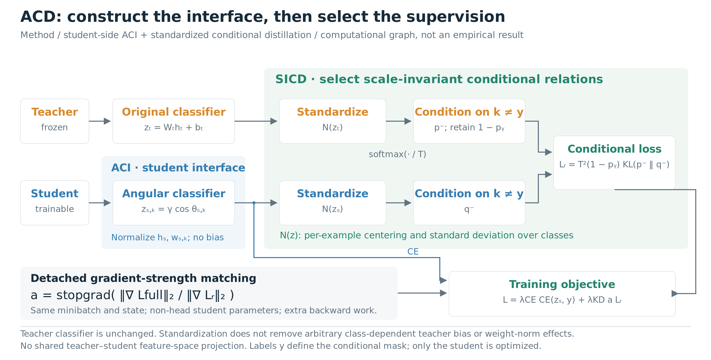
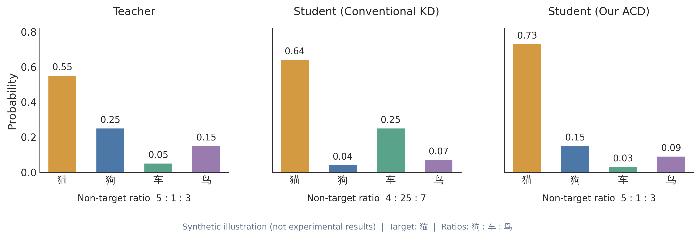

# ACD Introduction Figure and Narrative Assets

## Endpoint relation-residual diagnostic — historical empirical motivation


**Paper role: introductory symptom figure or supplementary empirical
motivation.** This figure asks whether the difference between teacher and
student outputs is explained solely by scalar confidence.  For every official
CIFAR-100 test image, it chooses the student's best positive scalar relative
to the frozen teacher, then computes the remaining weighted temperature-$4$ KL
between the calibrated student and teacher logits.  The calibration is an
oracle diagnostic that uses teacher outputs; it is never a deployed training
or inference operation.

It compares three completed 240-epoch endpoints under the recorded protocol:
linear KD (blue), cosine KD (green), and a cosine control that restores
sample-dependent amplitude (red).  The upper panels are empirical cumulative
distributions of the per-image residual, so a leftward curve means a smaller
residual.  The lower panels histogram the paired difference
`cosine residual - linear residual`; mass below zero means that cosine has the
smaller residual on that image.  Both seeds use the complete 10,000-image
official test set rather than selected examples.

| Seed | Linear residual | Cosine residual | Amplitude-restored residual | Images with lower cosine residual |
|---|---:|---:|---:|---:|
| 2051 | 0.5575 | 0.4116 | 0.5290 | 71.45% |
| 2052 | 0.5561 | 0.4123 | 0.5276 | 71.09% |

The figure supports one narrow observation: a substantial relation residual
remains after per-image scalar calibration, and the cosine endpoint reduces it
for most images in these two runs.  Restoring amplitude removes part of that
advantage, which is consistent with parameterization playing a role beyond
global confidence.  It does **not** show that angular scores are semantic
ground truth, that raw KD caused the residual, that cosine is always better,
or that training-time gradients conflict.  Since the head and learned endpoint
change together, it cannot identify the causal factor behind the reduction.

Use this figure before the method only as an empirical symptom.  The
fixed-direction and virtual-update figures below provide complementary local
mechanism evidence; the head $\\times$ supervision table tests whether an
interface effect is specific to KD; the conditional-supervision figure tests
the separate SICD selection question.  The complete extraction procedure,
source checkpoints, and per-class follow-up views are documented in the
[classifier figure guide](../../docs/CLASSIFIER_FIGURE_GUIDE_20261027.md#figure-01)
and [renderer](../../reproductions/head_story_visuals_20261027/relations.py).

Suggested caption: **Calibration-invariant relation residual in output KD.**
After an oracle per-image positive-scale calibration, cosine endpoints retain
lower teacher--student weighted KL residuals than linear KD on most test
images in two completed runs.  This endpoint diagnostic motivates, but does
not by itself establish, a classifier-coordinate mechanism.

## Parameterization → distribution → gradient-force analysis — 2026-11-11

The earlier aggregate ranking teaser is insufficient for the paper's central
mechanism claim: it shows that scores can change, but not how the resulting KD
signal changes. Two new editable, evidence-backed analysis figures therefore
make the causal chain explicit:

\[
z_k = \|h\|\|w_k\|\cos\theta_k + b_k
\;\longrightarrow\;
p_k=\operatorname{softmax}(z/T)_k
\;\longrightarrow\;
\nabla_h L_{\mathrm{KD}}=T\sum_k(p_k-q_k)w_k.
\]

The equation is exact. It has two distinct parameterization paths: scale and
class norms change the softmax coefficients \(p_k\), while class norms also
scale the basis vectors \(w_k=\|w_k\|u_k\). Bias changes the coefficients but
not a vector direction. Thus the correct statement is not that magnitude or
bias *rotates* \(\theta_k\); it is that they can change the output distribution
and, through the coefficients/bases above, the feature-gradient direction and
strength used in direct logit matching.

The evidence is a read-only CPU probe of the completed VGG13→MobileNetV1
linear-KD seed2102 epoch-240 checkpoint on the fixed first 128 official
CIFAR-100 test images. It does not train, reevaluate the official endpoint,
change any queue, or select a sample by accuracy. All source and checkpoint
SHA-256 records, the fixed-probe rule, complete probability paths, and
limitations are retained in [the machine-readable probe](mechanism_figures/parameterization_force_probe.json).
Regenerate it with:

```bash
CUDA_VISIBLE_DEVICES= .venv/bin/python -B paper_assets/acd_figures/extract_parameterization_forces.py
python3 paper_assets/acd_figures/render_parameterization_mechanism.py
```

### Question: why can unchanged angular directions induce different KD supervision?



[Editable SVG](mechanism_figures/mechanism_parameterization_force.svg) ·
[Vector PDF](mechanism_figures/mechanism_parameterization_force.pdf)

**Paper role: Analysis Fig. 1 — mathematical mechanism plus checkpoint-level
counterfactual.** Panel (a) derives the exact gradient dependence. Panel (b)
holds the student feature direction and all normalized classifier directions
fixed, then reconstructs scores while injecting the checkpoint's scale/norm
term and bias. It reports mean total-variation change of the non-target
conditional distribution. Panel (c) compares the resulting raw-KL feature
gradient to a standardized-logit diagnostic reference.

| Measured quantity | Value |
|---|---:|
| Angular → scale/norm conditional-distribution TV | 0.1816 |
| Scale/norm → raw-bias conditional-distribution TV | 0.0029 |
| Angular → raw conditional-distribution TV | 0.1817 |
| Raw-KL gradient cosine to standardized reference | 0.5631 |
| Raw-KL / reference feature-gradient norm | 14.72× |

The actual probe is scale-dominated: bias has a small incremental effect in
this particular checkpoint. That contrary pattern must stay visible; it means
the figure cannot claim that biases are always large or harmful. Likewise, the
standardized gradient is a diagnostic reference rather than a semantic oracle.
The result establishes a local parameterization sensitivity, not a universal
gradient-conflict theorem or an end-to-end ACD gain.

Suggested caption: **Classifier parameterization enters direct KD twice.** In
addition to changing softmax coefficients, class norms rescale the classifier
bases in the feature gradient. Fixed-direction reconstruction of one completed
checkpoint changes non-target distributions and yields a substantially
different local KD force; the scale contribution dominates this probe.

### Question: how can raw KD pull one student state away from a compatible reference force?



[Editable SVG](mechanism_figures/mechanism_virtual_update_plane.svg) ·
[Vector PDF](mechanism_figures/mechanism_virtual_update_plane.pdf)

**Paper role: Analysis Fig. 2 — local optimization visualization.** For one
pre-registered fixed-probe image (the median raw/reference cosine, not a
visually selected case), the plane is spanned by the standardized-logit feature
gradient and the component of raw-KL gradient orthogonal to it. Each arrow is
the negative gradient from exactly the same student feature, normalized class
directions, teacher target and temperature; only the score parameterization in
the student loss changes. The raw and scale/norm arrows visibly acquire the
same residual-axis component, while the bias-only perturbation is small for
this checkpoint.

This is the requested visualization of a student being *pulled* by the
parameterization: it is a virtual one-step force field, not a hand-drawn
cartoon. It must not be captioned as a full training trajectory. Establishing
that ACD changes this force persistently over epochs requires a separate
multi-checkpoint diagnostic; that evidence is currently absent.

Suggested caption: **Raw score matching induces a parameterization-sensitive
local update.** From one identical student state, replacing angular scores by
the checkpoint's scale/norm and bias terms changes the projected KD force. The
reference is diagnostic; arrows provide local mechanism evidence rather than a
claim about global optimization or generalization.

### Complete CVPR analysis-figure argument: what is established, and what remains

The paper should not use a generic “long vector, short vector, red conflict
arrow” cartoon as its main mechanism figure. Such a drawing incorrectly implies
that norms or biases literally rotate feature/classifier directions. The
stronger argument is a three-stage chain:

\[
\text{fixed angular relations}
\not\Rightarrow\
\text{compatible raw logits}
\Rightarrow\
\text{a parameterization-sensitive KD force}
\Rightarrow\
\text{potentially artifact-sensitive optimization.}
\]

The following plan is organized by the paper's questions, rather than by an
arbitrary figure-number sequence.

#### Question 1: why can fixed angles create different output supervision?

The correct mathematical starting point is

\[
z_k=r a_k\cos\theta_k+b_k,
\quad r=\|h\|,\;a_k=\|w_k\|,\;w_k=a_k u_k,
\]

and, for temperature-scaled KL distillation,

\[
\nabla_hL_{\mathrm{KD}}
=T\sum_{k=1}^{C}(p_k-q_k)w_k
=T\sum_{k=1}^{C}(p_k-q_k)a_ku_k.
\]

It exposes two separate paths. First, \(r\), \(a_k\), and \(b_k\) change
the softmax coefficients \(p_k\). Second, \(a_k\) changes the lengths of the
gradient basis vectors. Bias does not rotate a vector; it changes the mixture
coefficients. A class-specific bias also affects all softmax coordinates:

\[
\frac{\partial p_k}{\partial b_j}
=\frac{1}{T}p_k(\mathbb{1}[k=j]-p_j).
\]

**Required visual.** Use a three-panel analysis figure: (a) unit-circle
directions \(\hat h,u_k\) inside a geometry panel and \(r,a_k,b_k\) outside it;
(b) a fixed-direction counterfactual which injects scale/norm and bias into
the scores, showing non-target conditional-distribution deformation; (c) the
corresponding feature-gradient comparison. The new
`mechanism_parameterization_force` figure implements this argument at one real
checkpoint. It must say “parameterization changes the logit coordinate map,”
not “parameterization changes the angle.”

#### Question 2: how does the student get pulled during imitation?

The appropriate visualization is a force field, not a probability bar chart.
At a fixed student state, define a diagnostic geometry-compatible reference
gradient using standardized logits,

\[
g_{\mathrm{ref}}=\nabla_h L_{\mathrm{KL}}(N(z_s),N(z_t)),
\]

and form a two-dimensional plane from \(g_{\mathrm{ref}}\) and the component
of raw-KL gradient orthogonal to it. Starting from exactly the same feature,
teacher target, normalized directions and temperature, plot the SGD force
\(-\nabla_hL\) for angular scores, scale/norm scores, bias-only scores, and
raw scores. A residual-axis component is the visual signature of a different
local force; it is not automatically proof of harmfulness.

**Required visual.** The new `mechanism_virtual_update_plane` figure implements
this one-state virtual-update probe. It is stronger than a cartoon because each
arrow is measured, but it is not a training trajectory and must not be used to
claim long-run causality.

#### Question 3: does this local force persist over training, and does ACD alter it?

This evidence is **not yet available** and should be presented as a required
analysis follow-up, not fabricated from the existing figures. At checkpoints
\(1,30,120,240\), use a pre-indexed fixed probe to measure:

\[
D_{\mathrm{geo}}=D_{\mathrm{cond}}(N(z_s),N(z_t)),
\qquad
D_{\mathrm{raw}}=D_{\mathrm{KL}}(z_s,z_t),
\]

along with the raw/reference gradient cosine, gradient-norm ratio, feature norm,
classifier-norm dispersion, and bias-to-score ratio. Plot trajectories in the
\((D_{\mathrm{geo}},D_{\mathrm{raw}})\) plane for raw KD and ACD, with color
encoding an artifact-sensitivity measure. This answers whether raw matching can
lower raw discrepancy without comparably improving normalized non-target
relations, and whether ACD changes that path.

The design requires matched checkpoints for raw KD and ACD on the same pair and
seed; it cannot be inferred from the current linear-KD-only probe. If run, it
must restore model/BN/RNG after each virtual diagnostic and be reported as a
bounded diagnostic rather than an additional training selection criterion.

#### Figure roles in the paper

| Paper role | Visual evidence | Current state | Permissible conclusion |
|---|---|---|---|
| Teaser / Analysis 1 | Fixed-direction output and gradient mechanism | Complete, one pair/seed probe | Parameterization can change raw supervision and local force. |
| Analysis 2 | One-state virtual-update force plane | Complete, one selected-by-median sample | Raw and scale/norm scores can have a residual local-force component. |
| Analysis 3 | Multi-checkpoint raw-KD vs. ACD trajectory | Not yet run | None until matched diagnostics exist. |
| Method | ACI constructs angular student coordinates; SICD selects standardized conditional relations | Complete computational diagram | States the intervention, not its empirical proof. |

This division prevents two common overclaims: a static classifier diagram does
not establish an optimization trajectory, and a local force mismatch does not
by itself prove that ACD universally improves final accuracy.

### Cross-pair parameterization sensitivity: distribution deformation and force deviation — 2026-11-11

This update replaces the earlier single-checkpoint composite mechanism visual
with two **single-question figures**.  Neither image contains a mathematical
derivation or a prose headline; the derivation belongs in the analysis text and
the caption.  Both images are generated from the same read-only probe file and
are editable SVGs, with PDF and PNG exports.

#### Paper question: does restoring affine parameterization change the supervision that fixed angular directions produce?

[Distribution–force association](mechanism_figures/multimodel_deformation_force_association.svg)
uses five completed heterogeneous affine-head linear-KD checkpoints:
VGG13→MobileNetV1, ResNet50→MobileNetV1, ResNet32×4→ShuffleNetV1,
WRN40-2→ShuffleNetV1, and ResNet32×4→ShuffleNetV2.  All are epoch-240,
seed-2061 source-recipe pilots.  For each of the first 128 official CIFAR-100
test images, the probe fixes the image, the teacher's raw-logit target, and the
normalized student feature/classifier directions.  It contrasts the student's
angular score with its raw affine score.

Each faint point is one image.  Its horizontal coordinate is the total-variation
distance between the angular and raw **non-target conditional** distributions;
its vertical coordinate is (1-\cos(g_{\rm angular},g_{\rm raw})), where each
gradient is the KD derivative with respect to the same student feature.  Large
coordinates therefore mean that restoring parameterization has changed both the
dark-knowledge distribution and the local KD force.  The large outlined marker
is the mean for its colored architecture pair—not an extra experimental seed.

**How to read the revised figure.** The paper-facing panel uses a central
window (horizontal 0.10–0.45; vertical 0–1.60) so that the sample cloud and
pair means occupy the visual center. It deliberately suppresses sparse values
outside that window; the complete values remain in the linked probe JSON and
are not being represented as deleted observations. The tight standard in-plot
legend sits in the sparse upper-right region and maps color to each heterogeneous
pair. The number next to each colored mean marker is written compactly as
\(\mu(D_{\rm rel},D_{\rm force})\). Each transparent ellipse is an axis-aligned
IQR footprint centered on the pair median. It is a descriptive image-level
central range—not a confidence region, seed-level error bar, or claim of
Gaussianity. Both axes are divergences or angular deviations, so they are
dimensionless; no physical unit should be printed.

Across the five pairs, mean distribution deformation is 0.237/0.291/0.222/
0.295/0.228 and mean force-direction deviation is 0.539/0.427/0.765/0.806/
0.839, respectively in the pair order above.  This is evidence that the effect
is visible beyond one architecture, but not evidence of an accuracy gain,
causality over training, or architecture-independent effect size.

#### Paper question: does restoring parameterization rotate the local KD force, rather than merely rescale it?

[Parameterization-force trajectories](mechanism_figures/multimodel_parameterization_force_trajectories.svg)
is a **unit-norm force-direction fan plot**, not a feature embedding or a
force-magnitude comparison.  One row corresponds to one of the five pairs
above.  In its own local two-dimensional force basis, every mean
feature-level KD force is normalized to length one: the gray circle is the
angular-score reference; the colored square restores feature/classifier scale
and norms; and the colored diamond restores the full raw affine score.  All
three arrows start at the same origin, so their separation is an enlarged,
literal directional difference rather than a visually imperceptible difference
between force magnitudes.

The printed \(\Delta\theta\) is the raw-force rotation relative to the angular
reference: 71°, 73°, 80°, 85°, and 84° in the pair order above.  Hence the
local raw KD force cannot be represented as a positive scalar multiple of the
angular reference for these probes.  The colored square is visually close to
the diamond in these five cases.  That is an important, non-decorative result:
within this diagnostic, scale/norm restoration accounts for most of the
measured directional rotation, while the incremental bias contribution is
smaller.  The plot therefore does not overclaim a large independent bias
effect.

This transformation deliberately makes *direction* legible while discarding
force magnitude.  It should not be read as saying that all five pairs live in
a common literal feature space, that their force norms are equal, or that the
displayed angle is a seed-level statistic.  Together with the scatter, it
supports the narrower local mechanism statement: after fixed angular
directions are held constant, restoring affine parameterization can rotate the
KD feature gradient substantially.

Both figures derive from
[the extraction script](extract_multimodel_parameterization.py),
[the renderer](render_multimodel_parameterization.py), and the immutable
[probe values and source hashes](mechanism_figures/multimodel_parameterization_probe.json).
The checkpoint calculations are CPU-only and read-only: no new training,
selection by accuracy, official endpoint evaluation, or queue mutation occurred.

**Limitations.** The five checkpoints use one shared exploratory seed, the
images are not independent seeds, and the same source-recipe pilot family does
not establish an end-to-end ACI/SICD benefit.  The plot fixes the teacher target
while intervening on the student score parameterization; it therefore supports
the local mechanism claim, not a claim that teacher and student geometry has
been globally aligned.  A matched raw-KD-versus-ACD multi-checkpoint trajectory
diagnostic remains necessary before making an optimization-path claim.

### Image-conditioned normalized KD-force comparison — draft, 2026-11-11

[Image-conditioned force compass](mechanism_figures/image_conditioned_force_compass.svg)
is a deliberately more intuitive replacement candidate for the multi-pair
force fan.  It pairs real inputs with their measured local forces instead of
asking the reader to interpret five abstract pair averages.  The three images
are CIFAR-100 test images 66 (lion), 77 (bowl), and 31 (plate), selected before
rendering as the nearest distinct 25th, 50th, and 75th percentiles of
\(1-\cos(g_{\rm angular}, g_{\rm raw})\) in the same fixed first-128-image
VGG13→MobileNetV1, seed-2102, epoch-240 probe.  They were not chosen by
accuracy, predicted class, or visual appearance.

For each card, the actual 32×32 input is at left.  At right, the angular,
scale/norm-restored, and raw-affine **negative feature gradients** start at a
common origin.  They are projected onto that image's own angular/raw force
plane and set to the same length.  Gray, amber, and red distinguish angular,
scale/norm, and raw scores; the arrow geometry—not color intensity—encodes
direction.  Using color depth alone for a vector direction would be ambiguous:
it can encode magnitude but cannot encode a signed angle.  The fixed arrow
length is therefore intentional, and makes the raw rotations directly visible
across the three cards (129°, 112°, and 76°, respectively, with sign determined
by the local plane orientation).

The amber and red arrows nearly overlap.  This is measured rather than a
rendering accident: for these three examples, restoring scale/norm accounts for
nearly all of the raw direction change and the additional bias term is small.
The figure is a per-example explanatory panel; it does **not** replace the
five-pair scatter as cross-architecture evidence, nor show pixel-space
saliency, force magnitudes, or a common feature embedding.  The corresponding
[read-only extractor](extract_image_conditioned_forces.py),
[editable renderer](render_image_conditioned_forces.py), and
[probe record](mechanism_figures/image_conditioned_force_probe.json) preserve
the selection rule, inputs, force coordinates, and source hashes.

#### Same-input directional-disagreement supplement

[Directional-disagreement supplement](mechanism_figures/same_input_force_directional_disagreement.svg)
is the retained same-input visualization. It has three rows and three columns.
Within each row, the identical input appears under angular, scale/norm, and
raw-affine KD. Rows show the first three official CIFAR-100 test examples:
mountain (index 0), forest (index 1), and seal (index 2), using the recovered
VGG13→MobileNetV1 linear-KD checkpoint, seed 2051, epoch 240. The original
fourth mushroom row (index 3) is omitted for layout; all four measured inputs
remain in the source probe. This replaces the older seed-2102 two-example view.

Angular is the zero-disagreement reference.  In the other two columns, every
pixel's three-channel input force is compared to the angular force at that same
pixel.  The shared low-saturation Morandi scale encodes
\(1-\cos(g_{\rm local},g_{\rm angular})\): pale gray-pink means a small local
angle and muted brick red means a large one. A compact gradient bar labeled
0, 1, and 2 provides the shared color key beneath the method labels;
the same-input row semantics and selected examples belong in the caption.
The three method labels sit below one continuous, gap-free 3×3 grid.

This is deliberately supplementary.  It offers an intuitive, image-local view
of the feature-gradient mechanism, but does not replace the cross-pair
feature-level distribution–force association.  It visualizes input gradients,
not the complete RGB-vector field or an end-to-end causal result.  The
[pixel-force extractor](extract_release_pixel_forces.py),
[renderer](render_same_input_force_variants.py), and
[probe record](mechanism_figures/same_input_pixel_force_probe.json) preserve
the exact inputs, selection rule, gradients, and source hashes.

### Phase-plane evidence: components, external objectives, and output-loss replacement — 2026-11-12

The following three figures are **endpoint discrepancy scatter plots**.
Every colored point represents one completed arm's final epoch-240 checkpoint,
evaluated read-only on the same fixed first-128-image CIFAR-100 official-test probe.
Its horizontal coordinate is standardized non-target conditional-TV
discrepancy and its vertical coordinate is raw-logit KL discrepancy; lower is
better on either coordinate. A point lower and to the left of another point has
lower discrepancy on both axes. If one point is farther left but higher, the
two diagnostics disagree; there is no single winner without specifying which
diagnostic matters. Colors identify objective/pipeline. No points are connected.
The stored probe records retain epochs 1/30/120/240 for reproducibility, but
these three figures use only epoch 240 and do not describe temporal evolution.
Both metrics are dimensionless. The axes are cropped to show endpoint differences;
visual distances should be interpreted using the numerical ticks. These diagnostics are not
Top-1 and do not replace performance tables. No training, official-test
endpoint evaluation, or queue action occurred.

#### Question: do the ACI/SICD components have separable effects under a fixed protocol?



[Editable SVG](mechanism_figures/acd_component_ablation.svg) ·
[Vector PDF](mechanism_figures/acd_component_ablation.pdf)

This figure uses the strictly paired heterogeneous VGG13→MobileNetV1,
seed-2102 interaction run. The four colors denote Linear KD, ACI+KL,
ACI+standardized-full, and ACI+SICD. All arms share teacher, student
initialization, data order, epoch budget, and fixed diagnostic probe. At epoch
240, ACI+SICD is lowest on both plotted diagnostics (conditional TV 0.0467;
raw KL 1.565), versus Linear KD (0.0518; 1.581), ACI+KL (0.0530; 1.739), and
ACI+standardized-full (0.0484; 1.651). This is a within-pair component
mechanism observation only: one seed and two diagnostic quantities, not a
general performance or universality result.

#### Question: where does ACD sit among currently available logit-KD checkpoints?



[Editable SVG](mechanism_figures/acd_external_kd_provisional.svg) ·
[Vector PDF](mechanism_figures/acd_external_kd_provisional.pdf)

This is intentionally a **protocol-mixed descriptive inventory**, not a fair
external comparison. It compares Cosine KL, DKD, NCKD, LSKD, and ACD on
VGG13→VGG8, but checkpoints originate from different registrations, seed choices,
and, for LSKD, an author-source recipe. The outcome contradicts a blanket
superiority claim: DKD reaches the lower-left endpoint (conditional TV 0.0402;
raw KL 0.929), while ACD ends at (0.0432; 2.174). This can motivate a
fixed-protocol external comparison, but cannot rank methods, establish SOTA,
or support an ACD-win claim.

#### Question: can replacing only the output loss improve existing pipelines?



[Editable SVG](mechanism_figures/acd_plugin_replacement_pilots.svg) ·
[Vector PDF](mechanism_figures/acd_plugin_replacement_pilots.pdf)

This plot fixes each feature pipeline and compares cosine-KL and SICD
endpoints. AT uses ResNet32×4→ShuffleNetV1 and ReviewKD uses
WRN40-2→WRN40-1; both are paired seed-2101 pilots. In each pipeline SICD ends
with lower standardized non-target discrepancy, but higher raw KL: AT changes
from (0.0410, 1.196) to (0.0366, 1.333), and ReviewKD from (0.0446, 1.552) to
(0.0407, 2.741). Thus it demonstrates a coordinate tradeoff, not universal
dominance. One seed per distinct pipeline cannot establish consistency,
significance, or general performance advantage.
Only compare output-loss replacements within the same pipeline and pair:
absolute locations across AT and ReviewKD also reflect different teachers and
student architectures.

The figures are generated from the read-only
[phase-plane extractor](extract_acd_phase_plane_trajectories.py) and
[renderer](render_acd_phase_plane_trajectories.py). Their exact numerical
records are [component](mechanism_figures/acd_component_ablation_phase_plane.json),
[external](mechanism_figures/acd_external_kd_phase_plane.json), and
[replacement](mechanism_figures/acd_plugin_replacement_phase_plane.json).
To regenerate the three endpoint figures, run
`.venv/bin/python -B paper_assets/acd_figures/render_acd_phase_plane_trajectories.py`.
The historical Top-1 renderer now writes into `mechanism_figures/legacy_top1/`
to prevent accidental replacement of these diagnostic figures.
Their source records are,
respectively, `acd_cnn_interaction_20261109`,
`cvpr_reviewer_minimal_ready_20261106` plus `acd_cnn_interaction_20261109`,
and `acd_at_res32x4_sv1_priority_20261111` plus
`acd_reviewkd_wrn_priority_20261110`.

### Matched raw-KD versus ACD checkpoint trajectory — 2026-11-11

[Raw-KD versus ACD trajectory](mechanism_figures/raw_acd_checkpoint_trajectory.svg)
fills the previously identified trajectory-evidence gap for one strictly paired
comparison: VGG13→MobileNetV1, seed 2102, with checkpoints at epochs 1, 30,
120, and 240.  The red path is the registered affine-head `linear_kd` arm.  The
green path is the registered `cosine_standardized_full` arm, i.e., the current
ACI + full standardized-loss ACD construction.  Both checkpoints live in the
same interaction study and carry the same recorded initial-backbone hash.

This is a **single phase-plane figure**, rather than a multi-panel collage.
Each marker is a checkpoint (the `e#` labels are epoch numbers).  The horizontal
coordinate is total-variation discrepancy between teacher and student
non-target conditional distributions after per-sample logit standardization;
lower is better in the geometry-compatible coordinate system.  The vertical
coordinate is the ordinary temperature-4 raw-logit KL; lower is better in the
raw affine coordinate system.  The fixed probe contains the first 128 official
CIFAR-100 test images and was evaluated read-only.

At epoch 240, raw KD reaches a slightly lower raw KL (1.581 versus 1.651), while
ACD reaches a lower standardized conditional discrepancy (0.0484 versus
0.0518).  Thus this figure does **not** claim that ACD decreases every raw
quantity more quickly.  Its role is narrower and more informative: the two
objectives follow distinguishable paths, and the ACD arm finishes closer under
the relation metric it is designed to supervise even when raw KL favors its own
objective.  This is the required evidence that the local coordinate argument
can persist over this matched training path.

The values and hashes are reproducible from
[the trajectory extractor](extract_raw_acd_trajectory.py),
[the renderer](render_raw_acd_trajectory.py), and
[the probe record](mechanism_figures/raw_acd_checkpoint_trajectory_probe.json).
It introduces no new training, endpoint re-evaluation, checkpoint selection, or
queue action.  It remains one pair/seed/fixed probe; it is not a multi-seed
generalization result, and it does not by itself establish that this trajectory
causes the final accuracy difference.

## Evidence selection update — 2026-11-10

ACI 的主要验证继续使用普通 KL 的 head×supervision 交互实验。RKD 结果保留为
补充的“增加输出监督”证据，不作为 ACI 核心机制或“替换现有 KL”的证据。
通用替换部分优先使用已完成且通过配对审计的 ReviewKD-style+KL 三组对照：
Linear+KL 68.48、Cosine+KL 67.48、Cosine+SICD 70.43。
这是单 pair／seed 的结果，并不支持单独余弦头提升或普遍有效。
详见[实验角色与复用审计](../../reports/CVPR_FEATURE_COMPOSITION_AUDIT_20261108.md#current-decision--2026-11-10)。
后补的 ReviewKD full-standardized／DKD 结果与这三组初始化和输入记录不同，
不能混成严格配对的图。此次只调整证据定位，没有新增图、训练或修改现有图中数据。

## Rendered evidence-first figures

**2026-11-10：四张矢量图初稿已生成，均提供 SVG / PDF / PNG。**
这里只重新呈现已有记录，没有训练、重新推理或新梯度诊断。
实测数字来自已完成结果；公式图和计算流程明确标为数学／方法说明。
它们是可审阅的论文图初稿，不意味着原计划中的全部机制验证已经完成。

复现入口：[绘图脚本](render_evidence_figures.py)、
[冻结数据快照及来源 SHA-256](evidence_figures/evidence.json)、
[完整性测试](test_evidence_figures.py)。默认读取快照，不读取实时训练队列；
只有显式 `--collect` 才重新提取已完成记录。部分原始 ledger 尚未随文档发布，
快照保留被引用记录、最终 checkpoint 哈希和来源文件哈希，使重绘不依赖这些 ledger。

```bash
python3 paper_assets/acd_figures/render_evidence_figures.py --raster
python3 paper_assets/acd_figures/test_evidence_figures.py
```

SVG 生成仅依赖 Python 标准库；PNG/PDF 导出使用系统 librsvg 与 cairo。
SVG 保留可编辑文字与路径，PNG 为 2800 像素宽，PDF 为 7 英寸宽矢量图。
采用白底、统一字体、克制配色和无背景网格排版。不要把不同图中不同定义的
颜色当成统一语义：Teaser 按参数因素着色，Method 按师生分支着色，均在图中标注。

### 问题：参数化会改变传给学生的类别关系吗？



[可编辑 SVG](evidence_figures/teaser_parameterization.svg) ·
[论文 PDF](evidence_figures/teaser_parameterization.pdf)

**论文角色：Teaser，展示现象，不提前解释两个模块。** 左侧把真实线性头的
表达式分成方向、幅度、类别偏置；中间展示第一非真类发生变化的样本比例；
右侧展示前五非真类集合保留比例。可以直观理解为：同一张图像最像的几个
备选类别，会随着加入分类头范数／偏置而变化。

实验设置：已完成 ViT-T→ResNet8×4、seed 2102 的模型；CIFAR-100 官方测试集
固定前 256 张，无样本筛选。中图横轴为教师／线性学生，纵轴为变化率（%）；
橙色是 angular→dot-product，紫色是 dot-product→full logits。右图完整灰轨
表示 100% 集合保留；颜色沿用同一参数因素。左侧蓝色仅标方向项。

| 顺序比较 | 第一非真类变化率 | 前五非真类平均保留率 |
|---|---:|---:|
| 教师：加入幅度项 | 17.578% | 88.750% |
| 教师：再加入偏置 | 22.656% | 80.547% |
| 线性学生：加入幅度项 | 26.953% | 87.266% |
| 线性学生：再加入偏置 | 0.781% | 99.063% |

来源：[原 probe](artifacts/teaser_probe.json) 与 [提取定义](extract_teaser_probe.py)。
支持：类别相关参数因素确实可以改变排序。限制／反例：学生偏置效应很小，
大量样本排序不变；共同正尺度本身不会改变排序。这些顺序比较不是可相加的
独立因果贡献，也没有证明角度排序是真值、偏置一定有害或产生了梯度冲突。
原计划中的单样本概率变化面板尚无保存的逐样本数据，本版使用完整固定 probe
统计替代，没有手造类别概率。

Suggested caption: **Classifier parameterization changes the supervision
presented to a student.** Sequential reconstruction of real classifier scores
changes non-target rankings and top-five sets on a fixed probe. These descriptive
comparisons establish sensitivity, not the semantic correctness of angular scores.

### 问题：角度接口的结构性质是否等价于 KD 专属收益？



[可编辑 SVG](evidence_figures/analysis_angular_interface.svg) ·
[论文 PDF](evidence_figures/analysis_angular_interface.pdf)

**论文角色：Analysis，分离结构性质与性能证据。** 左侧灰线为同一 probe 来源的
线性学生 100 类权重范数，横轴按原类别编号而非排序；蓝线为归一化后每类
有效权重的单位范数，是构造性质，不是新测得的收益。纵轴为权重范数，单独
说明 γ=30 不含在该单位范数内。ACI 不改变教师头，也不能由此推出训练过程
中所有幅度影响均被消除。

右侧沿用用户指定的 head×supervision 检验：CE 和 KD 内分别只更换分类头，
比较相同 seed 的差值。ViT-T→ResNet8×4，240 epoch，最终重载的 10,000 张
官方测试集结果；CE-only 保留配方中的 CE 系数 0.1，KD 使用 CE/KD 系数
0.1/0.9，不能把此 CE-only 当成单独调优的常规 CE 基线。灰色为 CE head gain，
蓝色为 KD head gain，红色数字标记负交互；纵轴为百分点，从零起。

| Seed | Linear CE | Cosine CE | Linear KD | Cosine KD | KD head gain − CE head gain |
|---|---:|---:|---:|---:|---:|
| 2102 | 69.63 | 75.76 | 59.38 | 61.27 | −4.24 pp |
| 2103 | 70.01 | 75.54 | 59.28 | 60.76 | −4.05 pp |

支持：ACI 的前向坐标定义确实去除学生头偏置并归一化权重／输入方向。
反例：两个 seed 的 CE 收益均比 KD 收益大，因此不支持“本组结果证明 KD
专属改善”。只有两 seed，无显著性结论。这张图替代当前无法实测展示的
梯度敏感性面板，**不能当成梯度冲突诊断**；参数扰动曲线仍是待核查证据。

Suggested caption: **Structural normalization and KD-specific benefit are
distinct claims.** Although ACI fixes normalized classifier directions, the
paired head gains are larger under CE than ordinary KD in both tested seeds.

### 问题：标准化以后应该保留什么监督？



[可编辑 SVG](evidence_figures/analysis_conditional_supervision.svg) ·
[论文 PDF](evidence_figures/analysis_conditional_supervision.pdf)

**论文角色：第二组 Analysis，引出 SICD 的筛选目标。** 左侧是精确 KL 分解，
不是模拟数据：二元置信度项 B，加上教师非真类总概率加权的条件 KL。
右侧是 VGG13→MobileNetV1、seed 2101、45k/5k 学生训练／holdout 划分、
240 epoch 最终重载结果。所有学生均为 cosine head；横轴为 holdout Top-1，
采用点图、明确标出的 60–76% 范围，不使用截断基线柱状图。每行对应一个
已完成 arm，没有把 seed 或样本误画成重复试验。

| 监督／控制 | Top-1 | 梯度强度规则 |
|---|---:|---|
| Ordinary KD（蓝） | 68.62 | 普通 KD |
| Full standardized（灰） | 71.78 | 不额外匹配 |
| Confidence only（紫） | 64.54 | 匹配同状态完整标准化 KD 梯度范数 |
| Conditional only（绿） | 72.58 | 匹配同状态完整标准化 KD 梯度范数 |
| Full + norm control（深色） | 73.24 | 匹配同状态普通 KD 梯度范数；不同参考 |

来源：`amplitude_decoupling_20261101`、成功的
`signal_component_causality_loggingfix_20261102` 与
`standardization_mechanism_20261101` 的 completed、reload-verified 记录。
失败前序没有被重标为成功，控制结果按原 registration 复用。
支持：条件项比未额外匹配的完整标准化高 0.80 pp。
限制／反例：另一种强度控制达到 73.24，较条件项高 0.66 pp；两种匹配参考
不同，不能视为同一干预。教师见过这些 holdout 图像；单 pair、单 seed，
不能称作官方测试结果、显著改进或“置信度普遍有害”。完整控制还来自先前
跨 GPU 运行。目标信息仍可经标准化与非真类质量权重进入损失。
95.5% 的历史损失占比未用作有效性图，因为占比不等于效用。

Suggested caption: **Conditional supervision and gradient strength both matter.**
The conditional arm improves on the full standardized control in this pilot,
while a separate full-loss strength control performs better still. Matching
references differ; these single-seed holdout results are not universal evidence.

### 方法：先构造接口，再筛选监督



[可编辑 SVG](evidence_figures/method_acd.svg) ·
[论文 PDF](evidence_figures/method_acd.pdf)

**论文角色：Method overview，不作为实验结果。** 橙色教师分支保留原始分类头；
蓝色学生分支经过 ACI。ACI 背景只覆盖学生头，不覆盖教师头。绿色区域是
两侧标准化、softmax、非真类条件分布与加权 KL；CE 另行从学生原输出连接。
箭头代表实际张量／监督流，不表示实测改善。无测量坐标轴。

实现依据：`cvpr_angular_interface_interaction_20261109/study.py` 与 `losses.py`
（哈希在快照中）。γ=30，T=4；N 使用全类别 sample std（correction=1），
分母 clamp_min(1e-6)。主图省略数值保护细节而非改变公式。底部明确显示
当前实验使用的 detached minibatch 梯度范数比；它参考同状态 full standardized
KD，使用全部非 head 学生参数，带来额外反传，不可据此宣称无训练开销。
图中 L 表示 batch-reduced 目标时，a 是该 minibatch 的标量；上方关系公式
以单样本表示。教师冻结，只有学生被优化。

限制：这不是把师生异构特征投影到共同圆上；ACI 和标准化都不能抹除教师
任意类别相关偏置／范数。该图不证明优化兼容性、泛化或推理性能，旧漏斗和
圆形示意保留为历史草图，不再作为准确计算图。

Suggested caption: **ACD computational overview.** ACI changes only the student
classifier. SICD standardizes both class-output vectors and transfers weighted
conditional non-target distributions; CE and the implemented detached
gradient-strength matching are shown explicitly.

## Evidence-first figure plan

**2026-11-10 — Original design plan; see rendered evidence-first figures above.**
Four evidence-backed drafts are now rendered. The gradient-sensitivity curves
and per-example probability panels below remain unexecuted design proposals;
the actual drafts use existing aggregate probes and head interactions instead.
This primary figure guide follows the
[Background → Analysis → Method argument](../../reports/ACD_WRITING_ARGUMENT_20261110.md#figure-implications).
Organize figures by paper questions. This plan supersedes making one teaser
explain the problem and both modules. Existing assets below retain their original
provenance; this reorganization adds no experimental evidence.

### Why can fixed angular relations yield different supervision?

**Paper role: empirical teaser.** Example: two alternative classes retain their
angular-score ordering, but class-dependent norms/biases change which receives
the higher probability. This tests sensitivity, not which ordering is correct.

Layout: angular class scores → per-class norms/biases → conditional non-target
probabilities. Keep class colors fixed; arrows mark measured ordering changes.
Horizontal axis: class. Separate vertical axes: cosine score, norm/bias, and
probability. Compare angular, magnitude-weighted and full scores with explicitly
reported scale and temperature choices. Accompany any individual example with
a fixed-probe aggregate. If only some classes are displayed, state whether
probabilities normalize over all non-target classes or the displayed subset.

Existing [checkpoint image](acd_teaser_data_driven.svg) and
[values](artifacts/teaser_probe.json) use the first fixed 256 CIFAR-100 official-test
examples and completed seed-2102 ViT-T → ResNet8x4 checkpoints. Recorded non-target
top-order changes: teacher magnitude 17.6%, teacher bias 22.7%, linear-student
magnitude 27.0%, linear-student bias 0.8%. Preserve the extractor's sequential
comparison definitions; these are not independent causal contributions.
Supporting pattern: observed rank changes. Limiting/contrary patterns: unchanged
ordering and the small student bias effect. Common positive scale alone changes
confidence, not ranking. Angular scores are not ground-truth semantics.
**Gap:** relayout is pending; one pair/seed/probe does not establish generality
or harm. The synthetic probability image below cannot fill that evidence gap.

### Does parameterization change the learning signal?

**Paper role: first Analysis figure, motivating ACI.** Fix checkpoint, input and
angular terms; vary common scale, class-dependent norms and biases separately
under a documented protocol. Horizontal axis: perturbation strength. Separate
vertical axes: distribution divergence, ranking-change rate and gradient cosine.
Use consistent objective colors and intervention line styles. Report sample set,
temperature, checkpoint, parameter block and zero-gradient policy.

KD-gradient cosine relative to the unperturbed gradient measures sensitivity;
CE-versus-KD gradient cosine measures local conflict when negative. These are
different measurements, and neither alone proves final accuracy harm. Restore
model/BN/RNG after any virtual diagnostic; review scope before executing probes.
Supporting pattern: reproducible sensitivity. Contrary patterns: invariance,
no conflict or no downstream harm. Do not use red crosses as conflict evidence.

Use head × supervision interaction as a companion panel/table:
`(cosine KD − linear KD) − (cosine CE − linear CE)` with unchanged recipes and
paired seeds. Report every difference, including negative values; a cosine CE
gain is not KD-specific evidence. **Gap:** no new sensitivity or gradient data
were extracted here. Audit existing diagnostics before requesting experiments.

### Which supervision should be retained?

**Paper role: second Analysis figure, motivating SICD.** Left panel: explicitly
mathematical decomposition of standardized KL into binary target/non-target
confidence and weighted conditional non-target KL. Right panel: real matched
interventions on the same cosine interface—ordinary KD, full standardized KD,
confidence-only and conditional-relation supervision. Horizontal axis: arm;
vertical axis: final accuracy or paired difference, with individual paired seeds
where available. Keep full/confidence/relation colors consistent and distinct.

Disclose gradient-strength matching wherever used, including its compute cost.
Do not pool 45k/5k holdout and full-50k official-test outcomes or silently mix
matched/unmatched recipes. Supporting pattern: relation improves the matched
endpoint. Contrary pattern: neutral/negative relation-versus-full results;
retain all seeds. The existing probe's 95.5% conditional-loss share measures
loss magnitude, not useful knowledge or causal effectiveness. Target information
can remain through standardization and the conditional term's weight.
**Gap:** figure not rendered; verified intervention endpoints, not the loss-share
statistic alone, must supply the empirical panel.

### How do ACI and SICD implement the response?

**Paper role: Method overview, after Analysis.** Draw unchanged teacher classifier
and student ACI on separate branches, each followed by output standardization;
construct conditional non-target distributions and connect them to SICD. Draw
student CE separately. Teacher orange/student blue identify branches; arrows
mean tensor flow, not measured improvements. There are no quantitative axes.

Do not project heterogeneous features onto one literal shared circle or show
ACI removing arbitrary teacher norms/biases. Standardization cannot eliminate
arbitrary class-dependent teacher effects either. Include gradient-strength
matching in an inset/caption when used by the reported implementation. Existing
Draw.io assets below are conceptual drafts, not a verified final computation
graph. **Gap:** the revised method image has not been generated.

### Source and publication boundary

LIFT and PLACE inspires the phenomenon–analysis–method sequence. Its exact
captions and Algorithm 1 were not successfully rechecked; specific figure roles
remain provisional, not verified source claims. This documentation does not
authorize new training. Before rendering empirical figures, record checkpoints,
sampling, definitions, all paired outcomes and limitations here. Separate missing
presentation from missing experiments. Four proposed roles are not four completed
figures; existing images and detailed provenance remain available below.

## Simulated probability teaser

[Python source](plot_probability_teaser.py) uses matplotlib and seaborn and
exports PNG/PDF/SVG plus `values.json` under `simulated_probability_teaser/`.
Status: PNG/PDF/SVG and values have been generated on the server.



Run with a plotting environment:
`python plot_probability_teaser.py` (numpy, matplotlib, seaborn and a CJK font).

Paper role: illustrate the intended distinction between full probability matching
and preserving conditional non-target ratios. This is entirely hand-constructed:
no checkpoints, dataset samples, seeds, or measured outcomes are used.
The horizontal axis is class (猫/狗/车/鸟), and the shared vertical axis is
probability, starting at zero. Cat is the target. Class colors are identical
across panels: gold cat, blue dog, green car, purple bird.

Teacher probabilities are [0.55, 0.25, 0.05, 0.15]; conventional-student values
are [0.64, 0.04, 0.25, 0.07]; ACD values are [0.73, 0.15, 0.03, 0.09].
The non-target ratio is 5:1:3 in teacher and ACD, versus 4:25:7 in the deliberately
distorted conventional example. The ACD target confidence differs from the
teacher; its matching conditional ratio is imposed by construction. Numbers
above bars and a persistent synthetic label make the choice explicit.

These patterns explain a design goal, not measured support. Conventional KD
can preserve these ratios and ACD need not match them perfectly in real models;
real reversals or neutral outcomes must be shown when replacing this mockup.
KL matches softened distributions, not absolute logits, and is already invariant
to uniform additive logit shifts. Feature magnitude and class-dependent biases
can affect probabilities, but this illustration does not establish either as
the cause of gradient conflict. ACI modifies the student head; it does not
remove arbitrary teacher class-dependent bias. This synthetic image cannot
replace the data-driven empirical teaser.

## Signal transfer diagram

Open [acd_signal_transfer.drawio](acd_signal_transfer.drawio) in diagrams.net.
This editable conceptual figure contrasts raw supervision (top) with the ACD
design (bottom). Red balls represent candidate directional semantic content,
blue balls magnitude effects, and green balls bias effects. The red cross
denotes a possible conflict, while the green check denotes intended compatible
transfer. There are no measured axes, samples, or experimental results in this
illustration. Ball positions, sizes, counts, and the apparent cleanliness of
the output are schematic, not quantitative evidence.

The funnel and pipe explain the sequential roles of ACI and SICD. ACI modifies
the student classifier; it does not physically filter teacher features or remove
teacher class-dependent bias. SICD standardizes class outputs and transfers a
conditional non-target distribution; standardization does not remove arbitrary
class-dependent bias either. The green check is a design goal, not proof of
universal improvements. Conditional relations may still depend on target
information through normalization and probability weighting.

The supporting pattern to test is improved paired distillation and reduced
sensitivity to the registered transformations. Neutral or adverse head and
relation ablations contradict a universal interpretation and must be reported.
Use the data-driven teaser below for actual observations and their limitations.

## Editable motivation diagram

Open [acd_motivation.drawio](acd_motivation.drawio) in diagrams.net to edit the
two-panel motivation illustration. Its paper role is to introduce the proposed
classifier-geometry problem and the ACI/SICD response. It is conceptual: there
are no experimental samples, measured axes, fitted angles, or accuracy results.

Orange denotes the teacher, blue the student, red the proposed matching
conflict, and green the intended compatible relation transfer. The left panel
uses unequal vector lengths and a bias offset to suggest parameterization
effects. The right panel uses a circle and nearby directions to suggest angular
coordinates. Neither the red cross nor the green angle is a measured gradient
or evidence of improved transfer. Read this alongside the data-driven teaser
below, whose supporting observations and limits are separately documented.

The geometry is an analogy, not the computational graph: heterogeneous feature
spaces need not share dimensionality; KD matches class outputs rather than
feature/weight endpoints; scalar class bias is not a displacement in feature
space. ACI changes the student head, not both teacher and student heads. The
teacher arrow through the funnel must not be interpreted as a teacher-head
replacement. SICD transfers conditional distributions, not a literal angle
between teacher and student feature vectors. Adverse or neutral head/conditional
ablation results must be retained when evaluating the intended interpretation.

## Scope and status

`acd_intro_overview.svg` is the original editable conceptual layout for the
working paper narrative **Angular Conditional Distillation (ACD)**. It is not
an experimental visualization and should not be used as the paper teaser.
It has been superseded by the data-driven
[`acd_teaser_data_driven.svg`](acd_teaser_data_driven.svg), whose exact
read-only measurements are stored in
[`artifacts/teaser_probe.json`](artifacts/teaser_probe.json) and reproduced by
[`extract_teaser_probe.py`](extract_teaser_probe.py).

The data-driven teaser uses the first fixed 256 CIFAR-100 official-test
examples, with no sample selection, and completed seed-2102 ViT-T → ResNet8x4
checkpoints. It reports three descriptive observations only:

1. In raw trained classifiers, introducing magnitude or bias changes the
   non-target ordering relative to the corresponding angular score. The
   observed top-1 ordering-change rates are 17.6% (teacher magnitude), 22.7%
   (teacher bias), 27.0% (linear-student magnitude), and 0.8% (linear-student
   bias).
2. ACI removes per-class radial and bias terms from the student's

   *forward classifier coordinates*; it does not, by itself, prove a KD
   accuracy advantage.
3. For the completed cosine standardized-full checkpoint, the exact finite
   temperature-$4$ KL decomposition assigns 95.5% of the mean loss to the
   conditional non-target term and 4.5% to the binary target-confidence term.
   This is a decomposition observation, not evidence that relation-only
   training universally improves accuracy.

The following description applies to the superseded conceptual layout, which
remains useful only as an early method schematic:

1. Raw logit KD can entangle class relations with classifier
   parameterization-dependent effects.
2. The Angular Coordinate Interface (ACI) addresses *where* classifier-output
   knowledge is compared, by constructing angular category coordinates for the
   student classifier.
3. Scale-Invariant Conditional Distillation (SICD) addresses *what* is
   transferred, by standardizing outputs and transferring conditional
   non-target relations rather than directly enforcing absolute confidence.

The figure therefore supports the paper's conceptual framing; it does not
itself establish that ACI, SICD, or their composition improves accuracy.

## Figure guide

| Panel | Visual claim | Design |
|---|---|---|
| (a) Raw Logit KD | A raw linear classifier output mixes semantic relations with magnitudes and biases, so directly matching teacher/student logits can use incompatible coordinates. | Teacher/student logit bars differ in scale and offset. Blue/orange denote class-related variation, gray denotes nuisance parameterization, and the red dashed arrow denotes a potentially conflicting raw-KL update. |
| (b) ACI | The student classifier is represented by angular category coordinates. | A unit-circle schematic displays class directions and the cosine-classifier form $z_{s,k}=\gamma\cos\theta_k$. It intentionally does not depict ETF initialization, which is not the foundational ACI claim. |
| (c) SICD | Knowledge transfer should retain normalized conditional relations among non-target classes rather than directly fit absolute target confidence. | Gray denotes target confidence not directly matched; colored bars denote the relative non-target distribution selected for distillation. |

The color mapping is fixed throughout the draft: red = mismatch/conflict,
blue = angular-interface mechanism, green = conditional-relation mechanism,
and gray = parameterization-dependent or non-directly-matched quantities.

Suggested caption:

> **Figure 1.** Conventional logit distillation directly matches classifier
> outputs whose semantic relations are entangled with architecture- and
> training-dependent parameterization effects. ACD addresses this issue in two
> complementary steps. ACI constructs angular category coordinates for the
> student classifier, while SICD standardizes outputs and distills
> scale-invariant conditional relations among non-target classes.

## Evidence boundary

The diagram requires no new experiment to be used as an overview figure. Its
underlying scientific claims require the following evidence, which must be
reported separately from the visual:

- **ACI:** paired linear/cosine CE and KD controls, with the KD-specific head
  interaction as the estimand. The registered
  `reproductions/cvpr_angular_interface_interaction_20261109/` study is the
  current test of this claim.
- **SICD:** fixed-interface comparisons among full standardized KD and the
  gradient-matched conditional non-target objective, including a linear-head
  control. Existing controlled pilots establish only pair-specific evidence.
- **Generality and efficiency:** homogeneous/heterogeneous main tables,
  replacement experiments in feature/relation pipelines, and measured
  training-resource summaries. These are needed before universal or
  state-of-the-art wording is finalized.

## Citation plan

Introductory context should cite KD categories once, not repeatedly:

- **Logit KD:** Hinton et al., *Distilling the Knowledge in a Neural Network*.
- **Feature KD:** Romero et al., *FitNets*; Zagoruyko and Komodakis,
  *Attention Transfer*; Chen et al., *ReviewKD*.
- **Relation KD:** Park et al., *Relational Knowledge Distillation*; Tian et
  al., *Contrastive Representation Distillation*.

The direct output-level neighbors are:

- Zhao et al., *Decoupled Knowledge Distillation* (DKD);
- Wei et al., *Scale Decoupled Distillation* (SDD);
- Chi et al., *NormKD: Normalized Logits for Knowledge Distillation*;
- Sun et al., *Knowledge Distillation with Refined Logits* (RLD/LSKD);
- Huang et al., *DIST: Knowledge Distillation via Inter- and Intra-class
  Relation Transfer*;
- Jin et al., *Multi-Level Logit Distillation* (MLKD);
- Jeong et al., *Streamlined Knowledge Distillation* (SKD).

ACI may cite Wang et al., *NormFace*; Wang et al., *CosFace*; and Deng et al.,
*ArcFace* as angular-classifier background. The paper must not claim that
normalization, non-target modeling, or logit relations are novel in isolation.
Its proposed distinction is the joint treatment of compatible classifier
coordinates and scale-invariant conditional non-target relations.

For SKD, the manuscript should use the following precise distinction:

> SKD models batch-wise relations among normalized logits in the existing
> output coordinates, whereas ACD constructs a geometry-compatible classifier
> interface and transfers within-sample conditional relations among non-target
> classes.

## Working Introduction draft

```latex
\section{Introduction}

Knowledge distillation (KD) transfers knowledge from a powerful teacher model
to a compact student model. Existing methods enrich this transfer through
intermediate features, relational structures, or classifier outputs. Among
these knowledge sources, classifier outputs provide a uniquely universal
interface: they are directly task-aligned, available for arbitrary
teacher--student architectures, and can be distilled without feature adapters
or additional inference-time computation. However, despite these advantages,
existing logit objectives do not fully exploit the knowledge encoded by
classifier outputs.

We argue that the difficulty stems from the parameterization of a conventional
classifier. For a linear classifier, the logit of class $k$ can be written as
$z_k=\mathbf{w}_k^{\top}\mathbf{h}+b_k
=\|\mathbf{w}_k\|\|\mathbf{h}\|\cos\theta_k+b_k$. Hence, a logit
simultaneously encodes semantic category relations and parameterization-
dependent factors, including feature magnitudes, classifier norms, and biases.
These factors can differ substantially across architectures and training
trajectories. Direct logit matching implicitly assumes that the teacher and
student outputs are expressed in compatible category coordinates. When this
assumption fails, the student is forced to imitate quantities that are not
transferable, producing conflicting distillation gradients and corrupting the
inter-class relations that KD seeks to convey. We refer to this phenomenon as
\emph{classifier geometry mismatch}.

Recent logit-based approaches improve output supervision through decoupled
objectives, normalized or refined logits, and output-relation modeling. These
advances are complementary to our work. Nevertheless, they primarily modify
how information is weighted, normalized, or structured after the classifier
has defined its output coordinates. They do not jointly address whether the
category coordinates are compatible and which relations remain transferable
within those coordinates.

To address this issue, we propose \emph{Angular Conditional Distillation}
(ACD), a geometry-aware framework that rethinks both the classifier interface
and the knowledge transferred through it. First, ACD introduces the
\emph{Angular Coordinate Interface} (ACI), which reconstructs the student
classifier using angular category coordinates. By representing category
coordinates through directions, ACI emphasizes transferable directional
relations while suppressing magnitude- and bias-dependent effects. Second,
ACD introduces \emph{Scale-Invariant Conditional Distillation} (SICD). SICD
standardizes classifier outputs and conditionally distills relations among
non-target classes, rather than directly enforcing absolute confidence.
Together, ACI and SICD establish a geometry-compatible supervision paradigm:
ACI constructs compatible angular category coordinates, while SICD transfers
the scale-invariant conditional relations that remain meaningful across
classifier parameterizations.
```

The final results/contributions paragraph remains deliberately absent from
this frozen writing asset until the active experiments determine the scope of
the supported claims.
